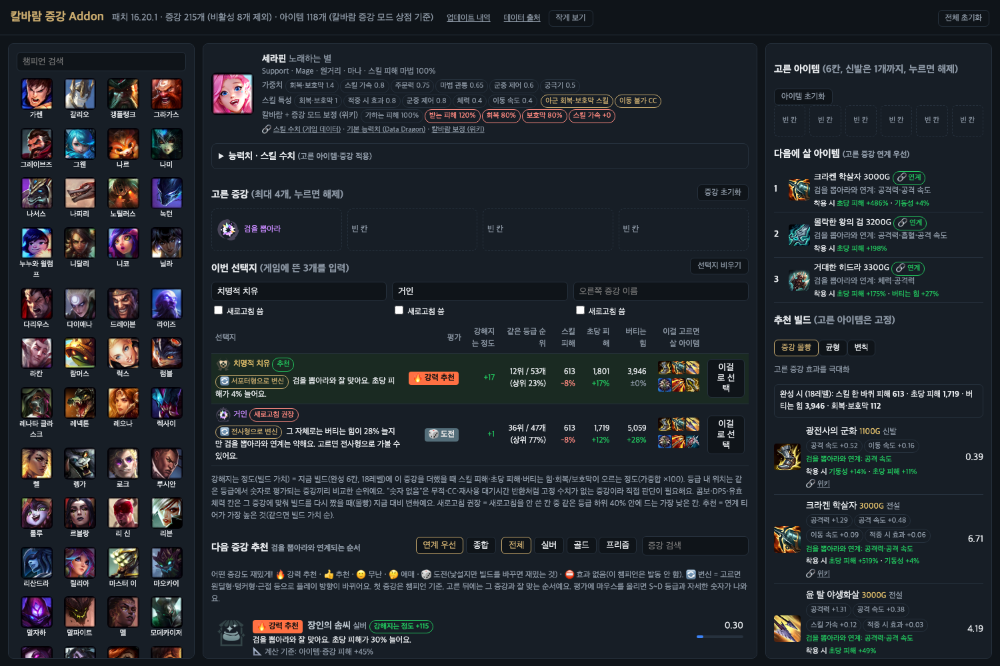

# 칼바람 증강 Addon

> **어떤 증강도 재밌게.** 서포터가 원딜처럼, 탱커가 근접 딜러처럼 — 고른 증강에 맞춰 다음 증강과 아이템을 안내하는 칼바람 증강 모드(아수라장) 도우미예요.

**[⬇️ 프로그램 받기 (윈도우·맥)](https://github.com/theddack/kalbaram-addon/releases/latest)** · [✅ 받은 파일 확인](https://theddack.github.io/kalbaram-addon/verify.html) · **[🌐 웹에서 바로 보기](https://theddack.github.io/kalbaram-addon/)** · [📖 사용 설명서](사용설명서.md) · [📝 업데이트 내역](업데이트내역.md) · [🔗 데이터 출처](https://theddack.github.io/kalbaram-addon/sources.html)



## 이런 걸 해요

| 기능 | 설명 |
|---|---|
| **첫 증강 추천** | 챔피언 스킬·능력치로 증강을 🔥강력 추천 ~ 🎲도전까지 나눠요 |
| **다음 증강 = 연계 순서** | 첫 증강을 고르면 그 증강과 잘 맞는 순서로 다시 나눠요. 🔄 변신(서포터 → 원딜형 등)도 알려 줘요 |
| **이번 선택지 비교** | 게임에 뜬 증강 3개를 넣으면 무엇이 얼마나 강해지는지, 새로고침할 칸은 어디인지 알려 줘요 |
| **다음에 살 아이템** | 고른 증강과 연계되는 아이템 순서. 추천 빌드는 증강 몰빵 · 균형 · 변칙 3가지 |
| **게임 연동** (프로그램) | 챔피언·레벨·산 아이템 자동 반영, **💰 지금 골드로 살 부품**, 게임 화면 위 표시(창 모드·테두리 없음), 상점 추천 칸 등록 |
| **📏 내 실측** (프로그램) | 게임이 끝나면 경기 결과를 저장해 가정값과 비교 (이름은 지우고 내 PC에만) |
| **매일 새 데이터** | 게임 데이터·위키·공식 패치 노트를 매일 받아요. 새 증강은 ✨, 이번 패치 변경은 🆕 표시. 패치 노트 숫자는 게임 데이터와 줄마다 맞춰 봐요 |
| **📐 근거 보기** | 숫자마다 게임 데이터인지, 설명 수치인지, 정한 값(⚠️ 가정)인지와 **그렇게 정한 이유**를 보여 줘요 |
| **쉽게 보기** | 처음엔 추천·이유·살 아이템만. 능력치 표·점수는 '자세히 보기'에서 |

숫자는 승률 통계가 아니라 **게임 데이터 수치로 계산**해요 (스킬 한 바퀴 피해, 초당 피해, 버티는 힘, 회복·보호막, 기동성, 제어력). 통계 사이트는 링크만 걸어요.

## 3단계로 시작

1. [릴리스](https://github.com/theddack/kalbaram-addon/releases/latest)에서 `KalbaramAddon-Windows.zip`(또는 Mac)을 받아요. 압축을 풀기 전에 **[받은 파일 확인](https://theddack.github.io/kalbaram-addon/verify.html)**에 끌어다 놓아 ✅인지 보고, 압축을 풀고 실행해요.
2. 롤 설정 → 비디오 → 창 모드를 **테두리 없음**으로 바꿔요.
3. 프로그램에서 **게임 연동**과 **게임 화면 표시**를 켜고 게임을 시작해요.

처음 실행 시 경고가 뜨면 [사용 설명서](사용설명서.md#처음-실행할-때-경고가-뜨면)를 보세요. 맥에서 "손상되었다"고 나오면 v0.1.3 이하 파일이에요. 최신 버전을 받으세요.

문제가 생기면 [GitHub 이슈](https://github.com/theddack/kalbaram-addon/issues)에 증강 선택 화면 스크린샷과 기록 파일을 올려 주세요.
기록 파일 위치: 윈도우 `C:\Users\(사용자 이름)\AppData\Roaming\AramAugment\logs\` (**윈도우 키 + R** → `%APPDATA%\AramAugment\logs` → 확인) · 맥 `~/Library/Application Support/AramAugment/logs/` — [자세히](사용설명서.md#기록-파일-위치)

## 정확도와 한계

**정확한 지표가 곧 재미**라서, 무엇을 계산하고 무엇을 못 하는지 그대로 적어요 (패치 16.20 기준).

| 항목 | 현재 |
|---|---|
| 숫자로 평가되는 증강 | **155 / 215개**. 나머지 60개 중 24개는 퀘스트·무작위·소환사 주문이라 종류로 표시하고, 36개는 특정 스킬·아이템에만 붙는 효과라 효과 종류로만 판단해요 |
| 숫자로 평가되는 아이템 고유 효과 | **62 / 118개** |
| 챔피언 패시브 | 96명이 계산에 들어가요 (중첩형 9명은 게임 중반 평균 중첩으로: 베이가·쓰레쉬·세나·초가스·사이온·스웨인·킨드레드·나서스·스몰더). 변신형 패시브는 아직이에요 |
| 스킬 수치 | 692개 스킬 중 **25곳**을 못 채웠어요 (게임 중 계산값 등). 능력치끼리 곱하는 식(닐라 Q 등)도 실제 능력치로 계산해요. 소환물 피해는 콤보에 안 들어가요. 최소~최대는 최대, 대체 버전(강화·카드)은 하나만 세요 |
| 상대 체력 % 피해 | 스킬 25명 + 증강·아이템·패시브가 계산에 들어가요. 상대 현재 체력은 70%로 가정해요 |
| 상대 | 기본은 전 챔피언 173명의 18레벨 추천 빌드 **중앙값**(체력 2470·방어력 113·마법 저항력 63). '상대'에서 챔피언을 고르면 그 챔피언 기준으로 계산해요 |
| 콤보 | Q·W·E·R 각 1번, 4초 기준이에요. 여러 번 맞히는 스킬과 지속 피해는 1번분만 세요 |
| 발동 빈도 | 설명 문구로 판정한 근사값이에요 (충전 공격은 기본 공격 8번에 1번) |
| 칼바람 보정 | 위키 표(일반 칼바람 + 증강 모드 전용 59명)를 써요. 위키 표의 기준 시점이 25.17이라 최신 패치와 다를 수 있어요 |
| 효과 분류 | 모든 증강이 효과 종류나 종류 표시(📜 퀘스트 · 🎰 무작위 · ✨ 소환사 주문)를 가져요 |
| 수치 일부 `?` | 16개 증강. 대부분 퀘스트 목표·게임 중 누적값이라 원래 숫자가 없어요 |
| 가정값 | 게임에 숫자가 없는 값(가동률·평균 중첩 등) 증강 36개·아이템 14개 + 공통 12개는 모두 **이유와 함께** 📐 근거·[계산 가정값](https://theddack.github.io/kalbaram-addon/sources.html#assumptions)에 적었어요. 실측이 아니라서 게임 기록이 모이면 바꿀 거예요 |
| 특수 규칙 | 증강 144개의 규칙(`rules.json`)은 설명을 읽고 사람이 판단한 것이고, 새 증강은 설명에서 🤖 자동 추정해요. 둘 다 실제 게임에서 검증하지 않았어요 |
| 패치 노트 | 줄마다 게임 데이터와 대조해요 (16.20: 30줄 중 ✅ 27 · 대조 불가 2 · 데이터에서 못 찾음 1). 게임 데이터가 늦으면 확실한 줄만 패치 노트 값으로 임시 계산해요 |
| 추천 결과 | 실제 게임 결과와 대조하지 않았어요. 게임 기록을 모아 대조할 계획이에요 |

미검증: 윈도우 실제 PC에서의 게임 화면 표시(창 찾기·클릭 통과·화면 배율), 게임 연동 실데이터(지금 골드 포함), 상점 추천 등록, 경기 결과 저장(실측).

테스트: 화면·계산 37개(`npm test`) + 파이썬 30개(`python -m unittest discover -s tests`). 빌드·사이트 배포·매일 갱신이 모두 테스트를 먼저 돌려요.

## 보안

공식 [릴리스 페이지](https://github.com/theddack/kalbaram-addon/releases/latest)에서 받은 파일만 쓰세요. 코드 서명이 없어서 경고가 뜨니, 경고를 넘기기 전에 **[받은 파일 확인](https://theddack.github.io/kalbaram-addon/verify.html)**에서 ✅ 공식 파일인지 확인하세요 (파일은 업로드되지 않고 브라우저에서 GitHub 공식 지문과 비교). 릴리스마다 SHA-256 체크섬과 GitHub 빌드 출처 증명이 있어요. 프로그램이 하는 일과 막아 둔 것은 [SECURITY.md](SECURITY.md)에 있어요.

## 데이터와 수집 원칙

- 라이엇 Data Dragon · CommunityDragon(게임 파일) · [리그 오브 레전드 위키](https://wiki.leagueoflegends.com/) (CC BY-SA 4.0) · 라이엇 공식 패치 노트
- 허용된 출처만, **하루 1번**, 출처를 남겨서 받아요. 승률 통계 사이트는 이용약관상 자동 수집하지 않아요.
- 전체 목록: [데이터 출처 페이지](https://theddack.github.io/kalbaram-addon/sources.html)

## 개발

데이터 수집·계산 방식·빌드·릴리스 방법은 [개발자 문서](docs/개발자_문서.md)에 있어요.

```sh
./run.sh                          # 데이터 받고 http://localhost:8765 로 띄우기
python3 build_data.py --refresh   # 패치 후 데이터 갱신
```

---

라이엇 게임즈와 무관한 팬 제작 도구입니다. League of Legends 및 관련 이미지·데이터는 Riot Games, Inc.의 자산입니다.
